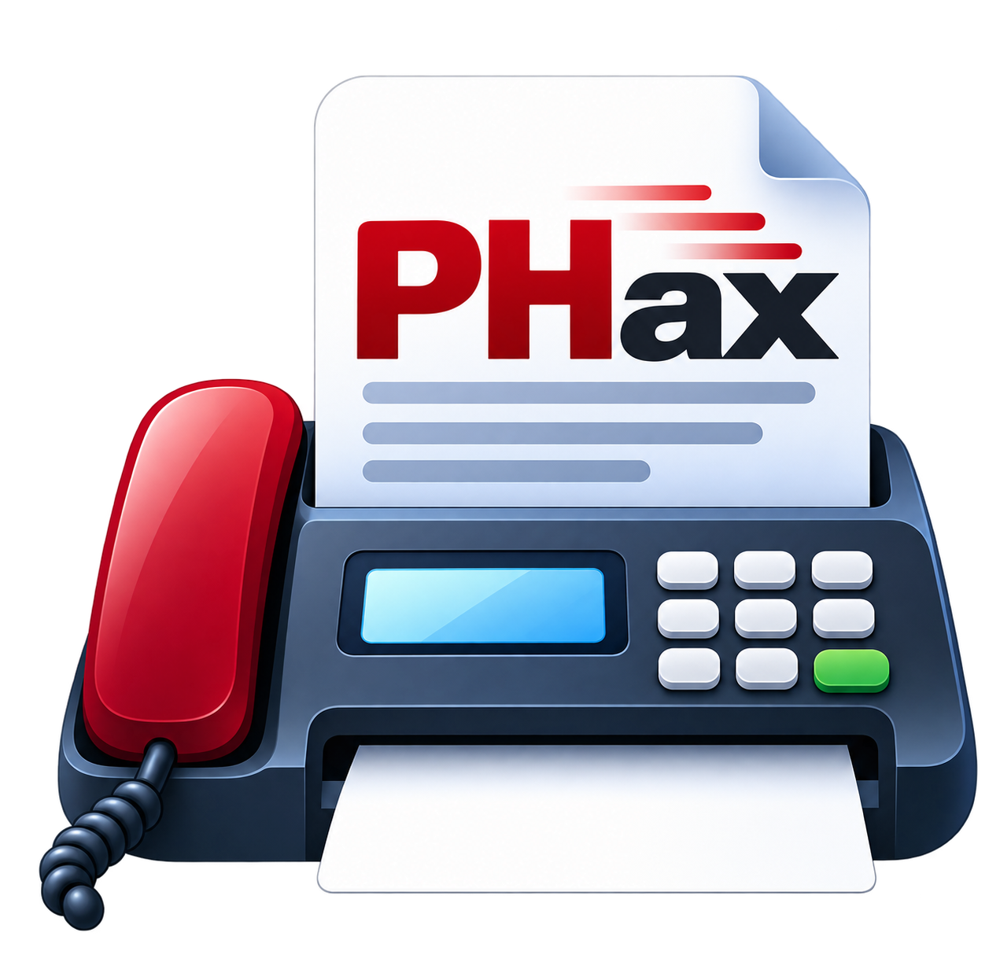

<p align="center"></p>

# PHax

PHax is a Windows fax application that sends and receives faxes through an ordinary **USB fax modem** — no fax
server, no online fax service, and no dependency on the Windows Fax Service or "Windows Fax and Scan".

It drives **Fax Class 1 / Class 1.0 (EIA-578 / ITU-T T.31)** modems directly and implements the fax protocol itself:
T.30 session negotiation, V.21 HDLC framing, training and speed fallback, and T.4 page coding, written in C#.

- **Desktop app** (WinUI 3): Incoming, Inbox, Drafts, Outbox and Sent; compose with PDF/TIFF/image/Word
  attachments and cover pages; preview, print, forward, PDF export; progress popup and Windows notifications.
- **Windows Service**: owns the modem, answers calls, sends the queue with automatic redial, keeps working when
  nobody is signed in, and prints received faxes automatically if you want it to.
- **Safe delivery accounting**: a fax is only marked *Sent* after the receiving machine confirms every page.
  If pages went out without confirmation it is marked *Unconfirmed* and never resent automatically.

## Status

PHax is young software. Real faxes have been sent and received with a **Conexant CX93001** USB modem (sold as the
StarTech USB fax modem). Other Class 1 modems should work through the generic
profile but have not been tested — reports are welcome (see [docs/HARDWARE-TESTING.md](docs/HARDWARE-TESTING.md)).

Known limitations: no ECM (error correction mode), no polling, A4/Letter width only (1728 pels), one modem per PC.
VoIP phone lines often break the fastest fax speed (V.17); PHax falls back to V.29 automatically and has a
"VoIP / digital phone line compatibility" setting.

## Requirements

- Windows 10 version 1809 or later, or Windows 11 (x64)
- A USB fax modem that supports **Class 1 or Class 1.0** (Class 2-only modems are not supported)
- An analog phone line (or a VoIP adapter port; see the limitation above)

## Install

Download `PHax-Setup-<version>.exe` from the releases page and run it. The installer:

- installs PHax to `C:\Program Files\PHax`,
- registers and starts the **PHax** Windows Service,
- stores faxes, the database and logs in `C:\ProgramData\PHax`.

Then open PHax, go to **Settings → Modem**, choose the modem's COM port and click **Test connection**.

The installer is not code-signed yet, so Windows SmartScreen shows a warning: choose *More info → Run anyway*.

## Build from source

Requirements: [.NET 10 SDK](https://dotnet.microsoft.com/download). Optional: Visual Studio 2026, and
[Inno Setup 6](https://jrsoftware.org/isinfo.php) for the installer (`winget install JRSoftware.InnoSetup`).

```powershell
dotnet build PHax.slnx -p:Platform=x64
dotnet test  PHax.Tests --filter "Category!=Hardware"

# Release build + installer (icon from logo.png, tests, publish, Inno Setup):
powershell -ExecutionPolicy Bypass -File .\scripts\build.ps1
# -> out\installer\PHax-Setup-<version>.exe
```

### Run without a modem

```powershell
dotnet run --project PHax.Service                    # the service as a console app
dotnet run --project PHax.App -p:Platform=x64         # the desktop app
```

In **Settings → Modem**, tick *use the built-in simulator*. PHax then talks to a simulated Class 1 modem and a
simulated remote fax machine; a red **SIMULATION MODE** banner is shown and nothing reaches a phone line. Use
`PHAX_DATA_ROOT=<folder>` to keep development data out of `C:\ProgramData\PHax`.

## How it works

```
PHax.App (WinUI 3)  ── named pipe ──►  PHax.Service (Windows Service, sole owner of the COM port)
        │                                     │
        └──── SQLite + documents in ProgramData\PHax ────┘
                                              │
            PHax.Modem:   T.30 engine ─ Class 1 driver ─ serial port ─► USB modem ─► phone line
            PHax.Imaging: T.4 MH/MR, T.6, TIFF, PDF, document conversion
```

| Project | Contents |
|---|---|
| `PHax.Core` | Models, settings, interfaces, retry policy, pipe protocol |
| `PHax.Modem` | Serial transport, Class 1 AT driver (DLE, HDLC FCS), T.30 sender/receiver, modem profiles, simulator |
| `PHax.Imaging` | T.4/T.6 codecs, multi-page TIFF and PDF writers, PDF/image/Word rasterisation, cover pages, printing |
| `PHax.Data` | Entity Framework Core (SQLite) context, migrations, job queue |
| `PHax.Service` | Modem supervisor, send/receive processors, named-pipe server, backup/restore |
| `PHax.App` | Desktop UI, tray icon, notifications, progress popup |
| `PHax.Tests` | Unit, simulation and hardware tests (xUnit v3) |

Background reading: [docs/ENGINE-EVALUATION.md](docs/ENGINE-EVALUATION.md) explains why PHax implements its own
Class 1 engine rather than wrapping efax or HylaFAX.

## Tests

- **Unit** — codecs (including an independent check that GDI+ decodes PHax's Group 4 TIFFs pixel-for-pixel),
  HDLC FCS, DIS/DCS bit fields, retry policy, queue recovery.
- **Simulation** — complete fax calls between PHax's own sender and receiver over two simulated modems, with
  injected faults: busy, no answer, failed training, lost confirmations, rejected pages, V.17 failing on a VoIP-like
  line, modem unplugged mid-page, cancellation.
- **Hardware** — real modem tests, skipped unless `PHAX_HW_PORT` is set. See
  [docs/HARDWARE-TESTING.md](docs/HARDWARE-TESTING.md).

## Contributing

Issues and pull requests are welcome. Hardware reports are especially useful: include the modem model, the
**Settings → Diagnostics → Export logs** output (it never contains page images) and what happened.

## License

PHax was created by Henry Phan under Phan Software. Copyright © 2026 Henry Phan (Phan Software).

Licensed under the [Apache License 2.0](LICENSE) with the **Commons Clause** License Condition v1.0: you may use,
modify and redistribute PHax under the Apache 2.0 terms, but you may not sell it, or sell a product or service
(including hosting or support) whose value derives substantially from it, without permission. Because of the
Commons Clause, PHax is source-available rather than OSI open source. See [LICENSE](LICENSE) and [NOTICE](NOTICE).

## Disclaimer

Fax is used for sensitive documents. PHax is provided as-is, without warranty; you are responsible for meeting
any privacy and record-keeping rules that apply to you.
